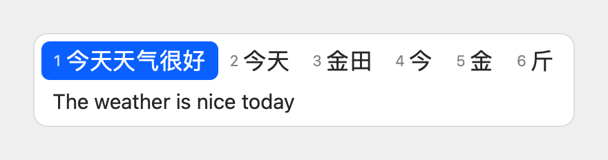
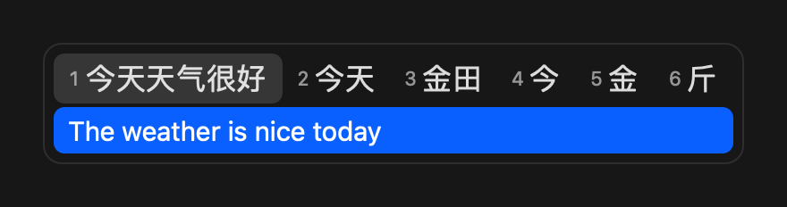

# YiKey 译键

一个 macOS 输入法：边打字边翻译。打拼音时，候选窗第一行是候选词，第二行是当前候选的实时译文，选哪一行就上屏哪一行。

*A macOS input method that translates as you type. Type Chinese pinyin and pick either the Chinese candidate or its live translation — fully offline, powered by Apple Translation.*

<p>
  
  
</p>

## 特性

- **实时两行候选**：第一行是拼音候选，第二行只翻译当前高亮的那一个，切换高亮译文跟着变
- **完全离线**：翻译使用 macOS 自带的 Apple Translation，输入内容不离开本机
- **全拼 / 双拼 / 五笔**：基于 [librime](https://github.com/rime/librime) 和 [雾凇拼音](https://github.com/iDvel/rime-ice) 词库，支持全拼（自带简拼，如 `nh` → 你好）、小鹤 / 微软 / 自然码双拼，以及五笔 86、五笔 98、新世纪五笔（`z` 键拼音反查）
- **连续选词组成整句**：选中的词先攒成整句，拼完一起翻译、一起上屏（可在设置中关闭）
- **词库自动更新**：每天在后台检查雾凇拼音的新词库，自动下载安装，无需操作
- **双向翻译**：Caps Lock 灯灭时 中文 → 外语，灯亮时 外语 → 中文
- **18 种外语**：英、德、法、西、意、葡、荷、波兰、土耳其、印尼、越南（双向），日、韩、俄、乌克兰、阿拉伯、泰、印地（仅 中文 → 外语）
- **键盘和鼠标都能选**：数字键选候选，`↓` / `Tab` 选译文，或直接点击
- 深色 / 浅色外观自动适配

## 系统要求

- macOS 26 或更高版本
- [Homebrew](https://brew.sh)
- Xcode Command Line Tools（`xcode-select --install`），不需要完整的 Xcode

## 安装

### 从源码编译

```bash
brew install librime
git clone https://github.com/owenuone/YiKey.git
cd YiKey
make install
```

`make install` 会下载雾凇拼音和五笔词库、编译、安装到 `~/Library/Input Methods/`，并预先编译词库。

### 分发给没装 Homebrew 的电脑

```bash
make dist
```

生成 `build/YiKey-<版本>.zip`，librime 及其依赖已打包进 App。对方解压后运行 `bash install.sh` 即可（仅支持 Apple Silicon、macOS 27 及以上；App 未经公证，安装脚本会去掉隔离标记）。

### 安装后

1. **添加输入法**：系统设置 → 键盘 → 输入法 → 编辑 → `+` → 简体中文 → **YiKey**（中文系统下显示为「译键」）
2. **关闭 Caps Lock 切换 ABC**：在同一个编辑界面里，关闭「使用大写锁定键切换"ABC"输入法」，否则 Caps Lock 会被系统拦截
3. **下载离线语言包**：菜单栏输入法图标 → 设置… → 翻译语言，点击「下载」；也可以在 系统设置 → 通用 → 语言与地区 → 翻译语言 中下载

## 使用

| 按键 | 作用 |
|------|------|
| `1`–`6` / `Space` | 选择候选词（开启「连续选词」时先进入整句，拼完后再按 `Space` 上屏） |
| `←` / `→` | 切换高亮候选，译文随之更新 |
| `-` / `=` | 翻页 |
| `↓` / `Tab` | 选中译文行，再按 `Space` / `Enter` 上屏译文 |
| `↑` / `Esc` | 从译文行回到候选行 |
| `Enter` | 上屏当前整句和高亮候选 |
| `Backspace` | 删除一个字母；拼音选完后删除整句的最后一个字 |
| `Esc` | 取消输入 |
| Caps Lock | 切换翻译方向（灯灭 中文 → 外语，灯亮 外语 → 中文） |
| 单按 Shift | 切换「直接英文」：字母直接上屏，不翻译；此时 Caps Lock 恢复为大写锁定 |

鼠标点击候选词或译文行也可以直接上屏。

输入方案（全拼 / 双拼 / 五笔）、「连续选词组成整句」和外语在 **菜单栏输入法图标 → 设置…** 中选择。

## 已知限制

- 外语 → 中文 方向只能输入 ASCII 字母，带重音的字符（é、ü、ñ）和越南语声调无法输入
- 日、韩、俄等非拉丁字母语言只支持 中文 → 外语；Caps Lock 灯亮时按 英语 → 中文 处理
- Apple 按语言组打包翻译模型，换到不同组的外语时，系统可能要求重新下载中文
- 唯一的联网操作是每天从 GitHub 下载雾凇拼音词库，不会发送任何输入内容
- 密码输入框中 macOS 会禁用第三方输入法

## 卸载

```bash
make uninstall
rm -rf ~/Library/Application\ Support/YiKey ~/Library/Logs/YiKey
```

然后在 系统设置 → 键盘 → 输入法 中移除 YiKey。

## 开发

```bash
make build      # 编译并组装 build/YiKey.app
make install    # 安装并重启输入法进程
make test       # 运行单元测试
make dist       # 打包自带依赖的分发版
make log        # 查看实时日志
```

架构和设计细节见 [CLAUDE.md](CLAUDE.md)。

## 致谢

- [librime](https://github.com/rime/librime)：Rime 输入法引擎（BSD-3-Clause）
- [雾凇拼音 rime-ice](https://github.com/iDvel/rime-ice)：词库与输入方案（GPL-3.0）
- [极点五笔 86 rime-wubi86-jidian](https://github.com/KyleBing/rime-wubi86-jidian)：五笔 86 方案与词库（Apache-2.0）
- [rime-wubi98](https://github.com/lotem/rime-wubi98)：五笔 98 方案与词库（GPLv3）
- [wubi06_rime](https://github.com/byujiang/wubi06_rime)：新世纪五笔词库（GPL-3.0）
- Apple Translation：离线翻译

## 许可证

[GPL-3.0](LICENSE)。安装包内打包了 GPL-3.0 授权的雾凇拼音、五笔 98 和新世纪五笔词库，因此本项目同样采用 GPL-3.0。
